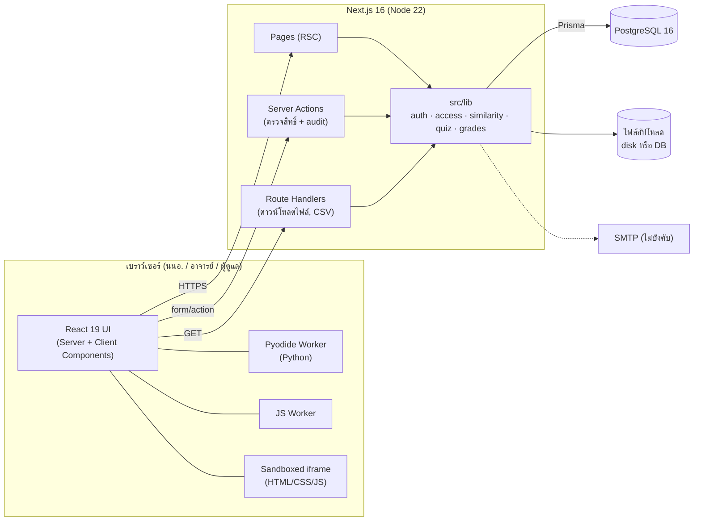
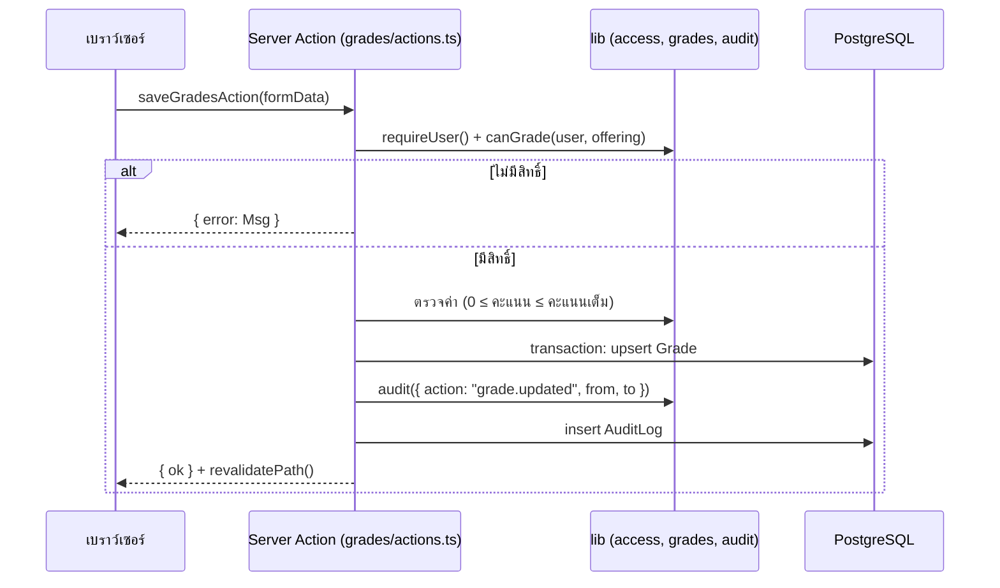
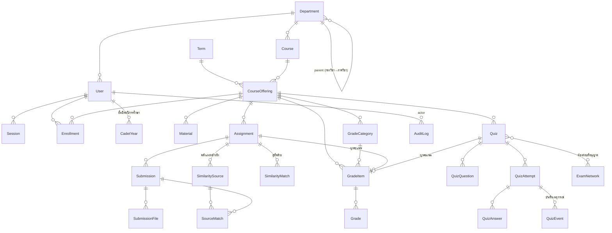
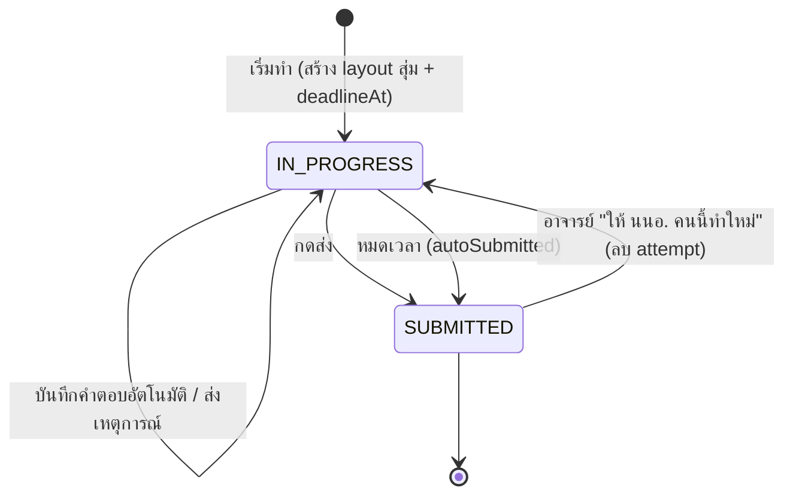

# Software Design Document — V.E.H.A.

| | |
|---|---|
| **ระบบ** | V.E.H.A. (Virtual Educational Hangar for Air-cadets) |
| **หน่วยงาน** | โรงเรียนนายเรืออากาศนวมินทกษัตริยาธิราช (รร.นอ.) |
| **ประเภทเอกสาร** | Software Design Document (SDD) |
| **สถานะ** | ใช้งานจริง (Phase 1–4 + code questions + reference library) |
| **ปรับปรุงล่าสุด** | พฤศจิกายน 2569 |

---

## สารบัญ

1. [บทนำ](#1-บทนำ)
2. [ผู้ใช้และบทบาท](#2-ผู้ใช้และบทบาท)
3. [ความต้องการของระบบ](#3-ความต้องการของระบบ)
4. [สถาปัตยกรรม](#4-สถาปัตยกรรม)
5. [แบบจำลองข้อมูล](#5-แบบจำลองข้อมูล)
6. [การออกแบบแต่ละโมดูล](#6-การออกแบบแต่ละโมดูล)
7. [ความปลอดภัย](#7-ความปลอดภัย)
8. [ส่วนติดต่อผู้ใช้](#8-ส่วนติดต่อผู้ใช้)
9. [ข้อจำกัดและงานในอนาคต](#9-ข้อจำกัดและงานในอนาคต)
10. [บันทึกการตัดสินใจด้านการออกแบบ](#10-บันทึกการตัดสินใจด้านการออกแบบ)

---

## 1. บทนำ

### 1.1 วัตถุประสงค์

V.E.H.A. เป็นระบบจัดการการเรียนการสอน (LMS) ที่ รร.นอ. พัฒนาเอง เพื่อใช้แทนการส่งงานทางอีเมล, Google Classroom หรือกระดาษ ความต้องการหลักมี 3 ข้อ

1. **ข้อมูลอยู่ในการควบคุมของสถาบัน:** ติดตั้งบนเซิร์ฟเวอร์ภายในได้ทั้งหมด ไม่ต้องพึ่งบริการ cloud ภายนอก
2. **ตรวจความซื่อสัตย์ทางวิชาการ:** ตรวจความคล้ายของงาน (รวมภาษาไทยและโค้ด) และคุมการสอบออนไลน์
3. **สิทธิ์ตามโครงสร้างของสถาบัน:** คะแนนแก้ได้เฉพาะอาจารย์ผู้สอน, นนอ. เห็นเฉพาะข้อมูลของตัวเอง, ทุกการกระทำสำคัญมีบันทึกตรวจสอบย้อนหลัง

### 1.2 ขอบเขต

**อยู่ในขอบเขต**
- บัญชีผู้ใช้และการยืนยันตัวตน (ไม่มี SSO)
- ภาคเรียน รายวิชา กลุ่มเรียน และการลงทะเบียน
- เอกสารประกอบการสอน
- งานที่มอบหมาย การส่งงาน และการตรวจความคล้าย (ระหว่างเพื่อน, งานรุ่นก่อน, เอกสารอ้างอิงที่อาจารย์เพิ่ม)
- แบบทดสอบออนไลน์ รวมข้อสอบเขียนโค้ดที่รันในเบราว์เซอร์
- สมุดคะแนนและการตัดเกรด
- โครงสร้างกองวิชา/ภาควิชา การนำเข้าข้อมูลจำนวนมาก และบันทึกการใช้งาน (audit log)

**อยู่นอกขอบเขต (ณ ปัจจุบัน)**
- ค้นหาความคล้ายกับอินเทอร์เน็ตอัตโนมัติ และตรวจงานที่เขียนด้วย AI (ต้องใช้บริการเสียเงิน ดู §9)
- ตรวจโค้ดอัตโนมัติด้วย test case (ข้อสอบโค้ดให้อาจารย์ตรวจเอง)
- ผู้ดูแลระบบระดับกองวิชา
- เชื่อมต่อระบบทะเบียน (ใช้ export CSV แทน)

### 1.3 คำศัพท์

| คำ | ความหมาย | ชื่อในโค้ด |
|---|---|---|
| นนอ. | นักเรียนนายเรืออากาศ (ผู้เรียน) | `Role.STUDENT` |
| ภาคเรียน | ภาค 1, 2 หรือ 3 (ฤดูร้อน) ของปีการศึกษา พ.ศ. | `Term` (UI ภาษาอังกฤษใช้คำว่า "semester") |
| รายวิชา | วิชาในหลักสูตร เช่น CS231 | `Course` |
| กลุ่มเรียน | รายวิชาที่เปิดสอนในภาคเรียนหนึ่ง (1 วิชาเปิดได้หลายกลุ่ม) ห้องเรียนจริงของระบบคือกลุ่มเรียน | `CourseOffering` (+ `section`) |
| กองวิชา | หน่วยระดับบน เช่น กองวิชาคณิตศาสตร์และคอมพิวเตอร์ (MC) | `Department` ที่ `parentId = null` |
| ภาควิชา | หน่วยระดับสองใต้กองวิชา เช่น ภาควิชาคอมพิวเตอร์ (CS) | `Department` ที่มี `parentId` |
| ความคล้าย | สัดส่วนของงานที่พบซ้ำกับแหล่งอื่น (0–100%) | `Submission.similarity` |
| คลังแหล่งอ้างอิง | แหล่งที่อาจารย์เพิ่มให้ตรวจเทียบ (งานรุ่นก่อน / เอกสาร) | `SimilaritySource` |

---

## 2. ผู้ใช้และบทบาท

### 2.1 บทบาทของระบบ (`User.role`)

| บทบาท | จำนวนโดยประมาณ | หน้าที่ |
|---|---|---|
| `ADMIN` ผู้ดูแลระบบ | 1–3 | จัดการบัญชี ภาคเรียน รายวิชา กลุ่มเรียน กองวิชา การตั้งค่าการสอบ ดูบันทึกการใช้งาน |
| `INSTRUCTOR` อาจารย์ | หลักสิบ | สอนในกลุ่มเรียนที่ได้รับมอบหมาย |
| `STUDENT` นนอ. | ~80 (CS) ขยายเป็นหลักร้อย | เรียนในกลุ่มเรียนที่ลงทะเบียน |

### 2.2 บทบาทในกลุ่มเรียน (`Enrollment.role`)

สิทธิ์ในห้องเรียนขึ้นกับ**การลงทะเบียนในกลุ่มเรียนนั้น** ไม่ใช่บทบาทของบัญชีเพียงอย่างเดียว

```
offeringAccess(user, offering)
  ADMIN                         → "manage"
  ลงทะเบียนเป็น INSTRUCTOR      → "manage"
  ลงทะเบียนเป็น STUDENT         → "view"
  ไม่ได้ลงทะเบียน                → null (ไม่มีสิทธิ์)

canGrade(user, offering)
  ลงทะเบียนเป็น INSTRUCTOR เท่านั้น → true
```

### 2.3 ตารางสิทธิ์

| การกระทำ | นนอ. | อาจารย์ผู้สอน | ผู้ดูแลระบบ |
|---|:-:|:-:|:-:|
| ดูเอกสาร/งาน/แบบทดสอบที่เผยแพร่ | ✅ | ✅ | ✅ |
| สร้าง/แก้เอกสาร งาน แบบทดสอบ คลังแหล่งอ้างอิง | — | ✅ | ✅ |
| ส่งงาน / ทำแบบทดสอบ | ✅ (ของตัวเอง) | — | — |
| ดูงานที่ส่งและรายงานความคล้าย | ของตัวเอง (เพื่อนเป็นนิรนาม) | ทั้งกลุ่ม | ทั้งกลุ่ม |
| ให้คะแนน, ตั้งค่าสมุดคะแนน, ตรวจข้อสอบ, ให้ทำแบบทดสอบใหม่ | — | ✅ | ❌ ดูได้อย่างเดียว |
| Export คะแนน CSV | — | ✅ | ✅ |
| ดูคะแนน | เฉพาะรายการที่เผยแพร่ | ✅ | ✅ |
| จัดการบัญชี ภาคเรียน รายวิชา รายชื่อ กองวิชา | — | — | ✅ |
| ดูประวัติการใช้งาน | — | — | ✅ |

> **เหตุผลที่ผู้ดูแลระบบแก้คะแนนไม่ได้:** คะแนนเป็นความรับผิดชอบของอาจารย์ผู้สอน การแยกสิทธิ์ทำให้บันทึกการแก้คะแนนทุกรายการชี้ไปที่อาจารย์ผู้สอนวิชานั้น ถ้าผู้ดูแลระบบเป็นอาจารย์ด้วย ให้ลงทะเบียนตัวเองเป็นผู้สอนในกลุ่มเรียนนั้น

---

## 3. ความต้องการของระบบ

### 3.1 ความต้องการเชิงฟังก์ชัน (สรุป)

| รหัส | ความต้องการ | โมดูล |
|---|---|---|
| FR-01 | เข้าสู่ระบบด้วย username/เลขประจำตัวและรหัสผ่าน, บังคับเปลี่ยนรหัสเมื่อเข้าครั้งแรก | Auth |
| FR-02 | ล็อกบัญชีชั่วคราวเมื่อใส่รหัสผิดติดกัน | Auth |
| FR-03 | ผู้ดูแลระบบรีเซ็ตรหัสผ่านโดยออกรหัสชั่วคราว (ใช้ได้ 14 วัน) | Auth / Admin |
| FR-04 | สร้างบัญชีทีละคนและนำเข้าจาก CSV | Admin |
| FR-05 | จัดการภาคเรียน รายวิชา กลุ่มเรียน รายชื่อ และนำเข้าตารางสอน | Admin |
| FR-06 | อาจารย์อัปโหลดเอกสาร/ลิงก์ จัดตามสัปดาห์ ซ่อน/เผยแพร่ได้ | Materials |
| FR-07 | สร้างงานพร้อมกำหนดส่ง รับงานส่งช้าหรือไม่, นนอ. ส่งข้อความและไฟล์ ส่งใหม่ได้ | Assignments |
| FR-08 | ตรวจความคล้ายระหว่างงาน, งานรุ่นก่อน และเอกสารอ้างอิง พร้อมไฮไลต์ | Similarity |
| FR-09 | แบบทดสอบ 5 ชนิดคำถาม, จับเวลาฝั่งเซิร์ฟเวอร์, สุ่มข้อ, บันทึกเหตุการณ์ | Quizzes |
| FR-10 | ข้อสอบเขียนโค้ด Python / JavaScript / HTML-CSS-JS รันในเบราว์เซอร์ | Code |
| FR-11 | สมุดคะแนนแบบหมวดถ่วงน้ำหนัก เกณฑ์ตัดเกรด เผยแพร่ทีละรายการ | Gradebook |
| FR-12 | คัดลอกเอกสาร งาน และการตั้งค่าคะแนนระหว่างกลุ่มเรียน | Sections |
| FR-13 | บันทึกการกระทำสำคัญ กรองและ export ได้ | Audit |
| FR-14 | กองวิชา/ภาควิชา พร้อมสีและโลโก้ | Departments |
| FR-15 | ภาษาไทย/อังกฤษ และธีมมืด/สว่าง | UI |

### 3.2 ความต้องการที่ไม่ใช่ฟังก์ชัน

| รหัส | ด้าน | ข้อกำหนด |
|---|---|---|
| NFR-01 | การติดตั้ง | ติดตั้งภายในสถาบันได้ด้วย Docker Compose โดยไม่ต้องใช้บริการภายนอก (ฟอนต์และ Pyodide อยู่ในแพ็กเกจ) |
| NFR-02 | ขนาดระบบ | รองรับผู้ใช้หลักร้อยคนบนเครื่อง 2 vCPU / 4 GB RAM |
| NFR-03 | ความปลอดภัย | รหัสผ่าน bcrypt cost 12, token เก็บเป็น SHA-256, ตรวจสิทธิ์ทุก server action |
| NFR-04 | การตรวจสอบย้อนหลัง | บันทึกการเข้าสู่ระบบ รหัสผ่าน การแก้คะแนน (ค่าเดิม→ค่าใหม่) และการแก้ข้อมูลของผู้ดูแลระบบ |
| NFR-05 | การรันโค้ด | โค้ดของ นนอ. ไม่รันบนเซิร์ฟเวอร์เด็ดขาด |
| NFR-06 | อุปกรณ์ | ใช้ได้บนหน้าจอกว้าง 360 px ขึ้นไป โดยไม่มี horizontal scroll |
| NFR-07 | ภาษา | ทุกข้อความมีทั้งภาษาไทยและอังกฤษ วันที่แสดงตามเวลาไทยและปี พ.ศ. ในโหมดไทย |
| NFR-08 | เวลา | เวลาที่ผู้ใช้กรอกตีความเป็นเวลาไทย (UTC+7) เสมอ ไม่ขึ้นกับเขตเวลาของเซิร์ฟเวอร์ |

---

## 4. สถาปัตยกรรม

### 4.1 ภาพรวม

ระบบเป็น **monolith** เดียว: Next.js (App Router) ทำทั้งหน้าเว็บ (React Server Components) และ business logic (Server Actions) เชื่อมกับ PostgreSQL ผ่าน Prisma



### 4.2 เทคโนโลยี

| ชั้น | เทคโนโลยี | เหตุผล |
|---|---|---|
| Framework | Next.js 16 (App Router, Server Actions, Turbopack), `zod` ตรวจค่าฟอร์ม, `nodemailer` ส่งอีเมล | หน้าเว็บและ backend อยู่ในโค้ดชุดเดียว ไม่ต้องดูแล API แยก |
| UI | React 19, Tailwind CSS 4 | `useActionState` สำหรับฟอร์ม, design token รองรับธีมมืด/สว่าง |
| ภาษา | TypeScript (strict) | ตรวจ i18n key และชนิดข้อมูลตอน build |
| ฐานข้อมูล | PostgreSQL 16 + Prisma 6 | migration ที่ตรวจสอบได้, query แบบ type-safe |
| Editor | CodeMirror 6 | เบา รองรับ Python/JS/HTML/CSS |
| Python runtime | Pyodide (self-hosted ใน `public/pyodide`) | รัน Python ในเบราว์เซอร์ ไม่ต้องมี sandbox ฝั่งเซิร์ฟเวอร์ |
| Text extraction | `unpdf` (PDF), `mammoth` (.docx) | ดึงข้อความจากไฟล์ที่ส่งเพื่อตรวจความคล้าย |
| 3D | three.js (เฉพาะหน้า sign-in) | ฉากหน้าเข้าสู่ระบบ ปิดเมื่อผู้ใช้ตั้ง reduced motion |
| ทดสอบ | Vitest, Playwright | unit test สำหรับ logic, e2e สำหรับ user flow |
| Deploy | Docker Compose (ภายใน) / Vercel + Neon (demo) | |

### 4.3 โครงสร้างการทำงานของคำขอ (Request flow)

**การอ่านหน้า**: เบราว์เซอร์ขอหน้า → Server Component เรียก `getSessionUser()` → ตรวจสิทธิ์ (`offeringAccess`) → query Prisma → render HTML ส่งกลับ ข้อมูลที่ผู้ใช้ไม่มีสิทธิ์จะไม่ถูกส่งไปที่เบราว์เซอร์เลย (เช่น เฉลยข้อสอบ, ชื่อเพื่อนในรายงานความคล้าย)

**การเขียนข้อมูล** (ตัวอย่าง: อาจารย์บันทึกคะแนน)



### 4.4 โครงสร้างโค้ด

```
prisma/
  schema.prisma              แบบจำลองข้อมูล
  migrations/                migration ทุกชุด (commit ทุกครั้ง)
  seed.ts                    admin เริ่มต้น, กองวิชา, หลักสูตร, (--demo) ข้อมูลตัวอย่าง
src/app/
  login, change-password, forgot-password, reset-password   หน้ายืนยันตัวตน (นอก app shell)
  exam/[attemptId]/          หน้าทำแบบทดสอบแบบเต็มจอ + actions
  (app)/                     หน้าที่ต้องเข้าสู่ระบบ (header, เมนู, การตั้งค่า)
    page.tsx                 หน้าแรก: แผง "สำหรับคุณ" + การ์ดวิชาตามภาควิชา
    courses/[id]/            ห้องเรียน: เอกสาร | งานที่มอบหมาย | แบบทดสอบ | คะแนน (แต่ละแท็บมี actions.ts)
    admin/                   users, courses, offerings/[id], departments, exam-settings, audit
    account/                 บัญชีของฉัน
  api/                       ดาวน์โหลดไฟล์, โลโก้, CSV คะแนน, CSV audit
src/components/              Modal, KeepForm, FileDropzone, InfoTip, ReportView, code/ …
src/lib/
  auth/                      นโยบายรหัสผ่าน, session, lockout, reset token
  i18n/                      en.ts (ต้นฉบับ key), th.ts, server/client helpers
  similarity/                tokenizer, k-gram engine, extraction, highlights, sources, breakdown
  quiz.ts / quiz-server.ts   logic แบบทดสอบ (pure) / ส่วนที่แตะฐานข้อมูล
  grades.ts                  คำนวณคะแนนและเกรด (pure)
  access.ts                  offeringAccess, canGrade
  audit.ts, audit-filter.ts  เขียนและกรองบันทึกการใช้งาน
  storage.ts                 ที่เก็บไฟล์ (disk / db)
  schedule-import.ts, csv.ts นำเข้าตารางสอนและบัญชี
  curriculum.ts              รายวิชาในหลักสูตร CS/MA
  departments.ts, brand.ts   สีและโลโก้ของหน่วยงาน, ชื่อระบบ
e2e/                         Playwright suites + runner + fixtures (ข้อมูลสมมติ)
```

หลักการแบ่งโค้ด: logic ที่ไม่ต้องใช้ฐานข้อมูล (คำนวณเกรด, ตรวจคำตอบ, tokenize) เป็น **pure function** ใน `src/lib` เพื่อให้ unit test ได้ ส่วน server action ทำหน้าที่ตรวจสิทธิ์ → ตรวจค่า → เขียนฐานข้อมูล → audit

---

## 5. แบบจำลองข้อมูล

### 5.1 ER Diagram (ตัดฟิลด์ย่อยออก)



### 5.2 ตารางหลัก

| ตาราง | หน้าที่ | Constraint สำคัญ |
|---|---|---|
| `User` | บัญชีผู้ใช้ | `username` unique, `email` unique (ไม่บังคับ), `mustChangePassword`, `tempPasswordExpiresAt`, `failedLoginCount`/`lockedUntil`, `isActive` |
| `Session` | session ที่เข้าสู่ระบบอยู่ | เก็บ `tokenHash` (SHA-256) ไม่เก็บ token จริง, หมดอายุ 7 วัน |
| `PasswordResetToken` | ลิงก์รีเซ็ตรหัสทางอีเมล | hash, 30 นาที, ใช้ครั้งเดียว (`usedAt`) |
| `Term` | ภาคเรียน | unique (`academicYear`, `semester`), มี `isCurrent` ได้ภาคเดียว |
| `Course` | รายวิชาในหลักสูตร | `code` unique (เช่น CS231, SS402) |
| `CourseOffering` | กลุ่มเรียน = ห้องเรียน | unique (`courseId`, `termId`, `section`), `gradeScale` (JSON), `showTotalToStudents` |
| `Enrollment` | ผู้สอน/ผู้เรียนในกลุ่มเรียน | unique (`userId`, `offeringId`) |
| `Material` | เอกสาร (ไฟล์หรือลิงก์) | `storageKey` ชี้ไปที่ storage |
| `Assignment` | งานที่มอบหมาย | `checkSimilarity`, `ignoreCommon`, `reportVisibility`, `baseText` |
| `Submission` | งานที่ส่ง (1 คน 1 แถวต่องาน, นับ `version`) | unique (`assignmentId`, `studentId`), `content` + `segments` = ข้อความที่ดึงแล้ว |
| `SimilarityMatch` | ผลเทียบคู่งาน | unique (`aId`, `bId`), เก็บ score และ span ทั้งสองฝั่ง |
| `SimilaritySource` / `SourceMatch` | คลังแหล่งอ้างอิงและผลเทียบแบบทางเดียว | `kind` = `DOCUMENT` / `PAST_ASSIGNMENT` |
| `GradeCategory` / `GradeItem` / `Grade` | สมุดคะแนน | `GradeItem` ผูกกับ `Assignment` หรือ `Quiz` ได้ 1:1, `isReleased` |
| `Quiz` / `QuizQuestion` | แบบทดสอบและข้อสอบ | `options`/`accepted`/`starter` เป็น JSON |
| `QuizAttempt` / `QuizAnswer` / `QuizEvent` | การทำข้อสอบ คำตอบ และบันทึกเหตุการณ์ | 1 คน 1 attempt ต่อแบบทดสอบ, `layout` = ลำดับข้อที่สุ่มแล้ว, `deadlineAt` |
| `CadetYear` | ชั้นปีของ นนอ. ต่อปีการศึกษา (ประวัติการเลื่อนชั้น) | unique (`userId`, `academicYear`) |
| `Department` | กองวิชา/ภาควิชา | `code` unique, `parentId` (2 ระดับ), `color`, `logoKey` |
| `ExamNetwork` | ห้องสอบและช่วง IP | |
| `AuditLog` | บันทึกการใช้งาน | index ตามเวลา, ผู้กระทำ, action, กองวิชา |
| `StoredFile` | เก็บไฟล์ในฐานข้อมูล (เมื่อ `STORAGE_DRIVER=db`) | key = `storageKey` |
| `AppSetting` | ค่าตั้งระดับสถาบัน (เช่น SEB Config Key) | key/value |

### 5.3 นโยบายการลบ

- ลบ `CourseOffering` → ลบเอกสาร งาน แบบทดสอบ คะแนนในกลุ่มนั้นทั้งหมด (cascade) ทำได้เฉพาะผู้ดูแลระบบ จากหน้าจัดการรายชื่อ และต้องพิมพ์รหัสวิชาเพื่อยืนยัน
- ลบ `Course` หรือ `Term` ที่มีกลุ่มเรียนอยู่ไม่ได้ (`Restrict`)
- **ไม่ลบบัญชีผู้ใช้** ใช้ "ปิดใช้งาน" (`isActive = false`) แทน เพื่อเก็บประวัติงานและคะแนน
- ลบ `Department` → รายวิชาและบุคลากรกลายเป็น "ไม่ระบุกองวิชา" (`SetNull`) และลบกองวิชาที่ยังมีภาควิชาอยู่ไม่ได้

### 5.4 Migration

- ทุกการเปลี่ยน schema ต้องมีโฟลเดอร์ใน `prisma/migrations/` และ commit เสมอ
- ข้อมูลอ้างอิง (กองวิชา, รายวิชาในหลักสูตร) ใส่ผ่าน `db:seed` แบบไม่เขียนทับสิ่งที่ผู้ดูแลแก้ไว้ และสำหรับฐานข้อมูลเดิมใช้ data migration (เช่น `*_curriculum_cs_ma`) ซึ่งมี unit test ตรวจว่าตรงกับ `lib/curriculum.ts`
- ขั้นตอนสร้าง migration ดู [development.md](development.md#3-migration)

---

## 6. การออกแบบแต่ละโมดูล

### 6.1 การยืนยันตัวตน (`src/lib/auth/`)

| หัวข้อ | การออกแบบ |
|---|---|
| ชื่อผู้ใช้ | นนอ. ใช้เลขประจำตัว, บุคลากรใช้ username (เช่น `firstname_x`) ตัวอักษรอังกฤษ ตัวเลข `._-` 3–32 ตัว |
| รหัสผ่าน | อย่างน้อย 8 ตัว มีทั้งตัวอักษรและตัวเลข ห้ามมี username อยู่ในรหัส, ไม่เกิน 72 byte (ข้อจำกัดของ bcrypt), เก็บด้วย bcrypt cost 12 |
| รหัสชั่วคราว | สุ่ม 10 ตัว (ไม่มีตัวที่สับสนง่าย เช่น 0/O, 1/l) หมดอายุตาม `TEMP_PASSWORD_DAYS` (ค่าเริ่มต้น 14 วัน) และบังคับเปลี่ยนเมื่อเข้าสู่ระบบ |
| Session | token สุ่มเก็บใน cookie `httpOnly`, `SameSite=Lax`, `Secure` (ตาม `COOKIE_SECURE`) ฐานข้อมูลเก็บเฉพาะ SHA-256 อายุ 7 วัน |
| Lockout | ผิด 5 ครั้งติดกัน → ล็อก 15 นาที (บันทึก `login.locked`) |
| เปลี่ยน/รีเซ็ตรหัส | ยกเลิก session อื่นของผู้ใช้ทั้งหมด |
| ลืมรหัสผ่าน | ถ้าตั้ง `SMTP_HOST`: ส่งลิงก์ทางอีเมล (30 นาที, ใช้ครั้งเดียว, จำกัด 3 ครั้ง/ชั่วโมง) ถ้าไม่ได้ตั้ง (ค่าปัจจุบัน): หน้าแจ้งให้ติดต่อผู้ดูแลระบบ |

### 6.2 ภาคเรียน รายวิชา และการนำเข้า (`admin/courses`, `lib/schedule-import.ts`, `lib/csv.ts`)

- **นำเข้าบัญชี (CSV):** คอลัมน์ `username, fullName, role, email, department, password` (เฉพาะ 2 คอลัมน์แรกที่บังคับ) role รับทั้ง `cadet/instructor/admin` และคำไทย (`นนอ.`, `อาจารย์`, `ผู้ดูแลระบบ`) ถ้าไม่ระบุรหัสผ่าน ระบบสุ่มรหัสชั่วคราวให้และแสดงครั้งเดียวพร้อมปุ่มดาวน์โหลด CSV ถ้าระบุ ต้องยาวอย่างน้อย 6 ตัว และยังต้องเปลี่ยนเมื่อเข้าครั้งแรก บัญชีที่มีอยู่แล้วจะข้าม (ไม่เขียนทับ)
- **นำเข้าตารางสอน:** คอลัมน์ `year, semester, code, title_th, title_en, credits, section, instructors[, cadets]` แปลงรหัสวิชาไทยเป็นอังกฤษ (`คต`→CS, `คณ`→MA, `ฟส`→PH, `คม`→CH, `สศ`/`ศส`→SS) สร้างภาคเรียน/รายวิชา/กลุ่มเรียนที่ยังไม่มี และลงทะเบียนอาจารย์และ นนอ. **ไม่แก้ข้อมูลที่มีอยู่แล้ว** จึงนำเข้าไฟล์เดิมซ้ำได้ ถ้ามี username ที่ยังไม่มีบัญชี ระบบปฏิเสธทั้งไฟล์และแจ้งรายชื่อ
- **ผูกกับภาคเรียนปัจจุบัน:** `Term.isCurrent` กำหนดว่าหน้าแรกแสดงภาคไหนเป็นค่าเริ่มต้น ภาคที่ใหม่กว่าภาคปัจจุบันแสดงเป็น "ภาคถัดไป" เพื่อให้อาจารย์เตรียมเนื้อหาล่วงหน้า
- **ชั้นปี (`CadetYear`, `lib/year-level.ts`):** เก็บ 1 แถวต่อ นนอ. ต่อปีการศึกษา (`userId`, `academicYear`, `yearLevel` 1–5) จึงมีประวัติทุกปี "ปีการศึกษาปัจจุบัน" คือปีของภาคเรียนปัจจุบัน (`currentAcademicYear()`) ใส่ได้จาก CSV (คอลัมน์ที่ 7 `year` ซึ่งตั้งชั้นปีให้บัญชีที่มีอยู่แล้วด้วย), ฟอร์มสร้างบัญชี และหน้าต่าง "จัดการ"
- **การเลื่อนชั้น (`promoteCadetsAction`, `planPromotion`):** นนอ. ที่ยังใช้งานและมีแถวในปี *Y* ได้แถวใหม่ในปี *Y+1* ที่ระดับ +1 ชั้นปีสุดท้าย (ค่าเริ่มต้น 4 เลือกได้) ไม่ได้แถวใหม่ = สำเร็จการศึกษา และเลือกปิดใช้งานบัญชีได้ แถวของปีเดิมไม่ถูกแก้ และผู้ที่มีแถวในปี *Y+1* แล้วจะถูกข้าม การรันซ้ำจึงไม่เปลี่ยนอะไร การเรียนยังผูกกับกลุ่มเรียนของแต่ละภาคเหมือนเดิม (ขั้นตอนดู [operations.md](operations.md#งานต้นภาคเรียน--ต้นปีการศึกษา))
- **ลบกลุ่มเรียน (`deleteOfferingAction`):** เฉพาะผู้ดูแลระบบ ต้องพิมพ์รหัสวิชายืนยัน หน้าต่างแสดงจำนวนสิ่งที่จะหายไป ระบบเขียน audit `offering.deleted` ก่อนลบ (เพื่อให้ผูกกองวิชาได้) แล้วลบไฟล์ใน storage ของเอกสารและงานที่ส่ง

### 6.3 เอกสาร (`courses/[id]` แท็บเอกสาร)

- เป็นไฟล์ (อัปโหลด ≤ `MAX_UPLOAD_MB`) หรือลิงก์ จัดตามสัปดาห์ ซ่อน/เผยแพร่ได้
- ดาวน์โหลดผ่าน `/api/materials/[id]/download` ซึ่งตรวจสิทธิ์ทุกครั้ง (นนอ. ดาวน์โหลดเอกสารที่ซ่อนอยู่ไม่ได้)
- ไฟล์บนดิสก์ใช้ชื่อสุ่ม ชื่อเดิมเก็บในฐานข้อมูล

### 6.4 งานที่มอบหมายและการส่งงาน (`courses/[id]/assignments`)

- งานมี: ชื่อ, คำสั่งงาน, กำหนดส่ง (เวลาไทย), รับงานส่งช้า, เผยแพร่, ตรวจความคล้าย, ไม่นับข้อความที่ซ้ำเกินครึ่งชั้น, การมองเห็นรายงาน (`IMMEDIATE` / `AFTER_DUE` / `HIDDEN`), ข้อความตั้งต้นที่ไม่นับ (`baseText`), คะแนนเต็มและหมวด (สร้าง `GradeItem` ให้อัตโนมัติ)
- การส่ง: ข้อความ + ไฟล์ไม่เกิน 5 ไฟล์ ไฟล์ละไม่เกิน 20 MB (และรวมไม่เกิน `MAX_UPLOAD_MB` ต่อครั้ง) ส่งใหม่ได้จนปิดรับ ส่งใหม่แต่ละครั้งเพิ่ม `version` และเขียนทับงานเดิม
- เมื่อส่ง ระบบดึงข้อความ (`lib/similarity/extract`) เก็บใน `content` + `segments` แล้วตรวจความคล้ายทันที

### 6.5 การตรวจความคล้าย (`src/lib/similarity/`)

**อัลกอริทึม:** k-gram fingerprinting แนวเดียวกับ MOSS/Dolos

1. **Tokenize**
   - ข้อความ: ตัดคำด้วย `Intl.Segmenter` (ICU) จึงรองรับภาษาไทยที่ไม่มีเว้นวรรค ตัดเครื่องหมายวรรคตอน แปลงเป็นตัวพิมพ์เล็ก
   - โค้ด: ตัดคอมเมนต์, แทนชื่อตัวแปรด้วย `ID` และ literal ด้วย `STR`/`NUM` จึงจับงานที่แค่เปลี่ยนชื่อตัวแปรได้
2. **Fingerprint:** hash ทุกลำดับ k token ติดกัน (ข้อความ k = 8 คำ, โค้ด k = 23 token)
3. **ตัดส่วนที่ไม่นับ:** ข้อความตั้งต้น (`baseText`) และ (ถ้าเปิด `ignoreCommon` และมีงาน ≥ 4 ชิ้น) fingerprint ที่พบในงานเกินครึ่งชั้น
4. **เทียบ:** ทุกคู่ในงานเดียวกัน → `SimilarityMatch` (span ทั้งสองฝั่ง) และงานกับแหล่งในคลังแบบทางเดียว → `SourceMatch`
5. **คะแนน:** สัดส่วน token ของงานที่อยู่ใน span ที่ตรงกับแหล่งใดแหล่งหนึ่ง (union ไม่นับซ้ำ) → `Submission.similarity`
6. **แยกตามแหล่ง** (`breakdown.ts`): คำนวณแยก "เพื่อนในวิชา / งานรุ่นก่อน / เอกสารอ้างอิง" ข้อความหนึ่งอาจตรงหลายแหล่ง ผลรวมของสามช่องจึงอาจมากกว่าตัวเลขรวม

**ระดับ:** < 15% ต่ำ, 15–40% ปานกลาง, ≥ 40% สูง (แสดงในแผง "งานที่ต้องจัดการ" ของอาจารย์)

**ไฟล์ที่ตรวจได้:** ข้อความ, โค้ด, PDF, .docx, .ipynb ไฟล์ชนิดอื่นเก็บไว้แต่ไม่ตรวจ PDF ภาษาไทยที่ใช้ฟอนต์รุ่นเก่าซึ่งดึงสระ/วรรณยุกต์เพี้ยน ระบบตรวจพบแล้วแสดงว่า "ไม่ได้ตรวจ" แทนการให้ค่าผิด

**การปกปิดตัวตน:** รายงานของ นนอ. แสดงแหล่งเป็น "งานของเพื่อน #1, #2" และงานรุ่นก่อนเป็นนิรนามเสมอ เนื้อหางานของคนอื่นไม่ถูกส่งไปที่เบราว์เซอร์ของ นนอ.

**หลักการ:** ค่าความคล้ายเป็น**สัญญาณให้ตรวจสอบ ไม่ใช่หลักฐานการทุจริต**

### 6.6 แบบทดสอบ (`courses/[id]/quizzes`, `app/exam`, `lib/quiz.ts`)

**ชนิดคำถาม**

| ชนิด | การตรวจ |
|---|---|
| `SINGLE` ปรนัยตอบข้อเดียว (รวมถูก/ผิด) | อัตโนมัติ |
| `MULTIPLE` ปรนัยหลายคำตอบ | อัตโนมัติ คะแนนบางส่วน = max(0, (ถูก − ผิด) ÷ จำนวนคำตอบที่ถูก) × คะแนนข้อ |
| `SHORT` คำตอบสั้น | อัตโนมัติถ้าตรงกับคำตอบที่ยอมรับ (ไม่สนตัวพิมพ์และช่องว่าง) ไม่ตรง → อาจารย์ตรวจ |
| `ESSAY` อัตนัย | อาจารย์ตรวจ |
| `CODE` เขียนโค้ด (Python / JavaScript / HTML-CSS-JS) | อาจารย์ตรวจ (รันโค้ดดูผลได้ในหน้าตรวจ) |

**วงจรของ attempt**



- `deadlineAt = min(เริ่ม + เวลาทำ, เวลาปิดสอบ)` คำนวณและบังคับฝั่งเซิร์ฟเวอร์ มีช่วงผ่อนผัน 30 วินาทีสำหรับคำตอบที่ส่งมาช้าเพราะเครือข่าย
- **เฉลยไม่ถูกส่งไปที่เบราว์เซอร์** ระหว่างสอบ
- ตรวจครบทุกข้อแล้ว คะแนนจะไหลเข้า `GradeItem` ที่ผูกกับแบบทดสอบ
- ถ้าแก้เฉลยหลังมีคนทำแล้ว ระบบตรวจข้อที่ตรวจอัตโนมัติใหม่ แต่ไม่เปลี่ยนคะแนนที่อาจารย์ให้เอง

**การคุมสอบ**
- ปัจจุบันใช้**โหมดเต็มจอในเบราว์เซอร์ปกติ + อาจารย์คุมสอบในห้อง** โหมด Safe Exam Browser ยังอยู่ในโค้ดแต่ปิดไว้ (`SEB_ENABLED`) โค้ดต้องเรียก `sebRequired(quiz)` ไม่ใช่อ่าน `quiz.requireSeb` ตรงๆ
- บันทึกเหตุการณ์ (`QuizEvent`): ออกจากหน้าต่าง, สลับแท็บ, ออกจากโหมดเต็มจอ, พยายาม copy/paste/วาง/คลิกขวา (ถูกบล็อกตั้งแต่ capture phase จึงข้าม editor ไม่ได้), โหลดหน้าใหม่, ทำต่อจากอุปกรณ์หรือ IP อื่น การคลิกเข้าไปในกรอบแสดงผลโค้ด (iframe) ไม่นับเป็นการออกจากหน้าสอบ
- จำกัดห้องสอบด้วย IP/CIDR (`ExamNetwork`) ซึ่งผู้ดูแลระบบตั้งไว้ อาจารย์แค่เลือกห้อง

### 6.7 การรันโค้ด (`components/code/`, `public/runners/`, `lib/code.ts`)

| ภาษา | ที่รัน | การแยก |
|---|---|---|
| Python | Web Worker + Pyodide (โหลดจาก `/pyodide` ของระบบเอง) | worker แยก thread, รองรับ `input()` จากช่อง stdin |
| JavaScript | Web Worker (สร้างใหม่ทุกครั้งที่รัน) | ไม่มี DOM, ไม่มี cookie |
| HTML/CSS/JS | `<iframe sandbox="allow-scripts" srcdoc>` | origin แยก ไม่เข้าถึงหน้าหลัก cookie หรือ session ได้ ส่ง console กลับด้วย `postMessage` + token |

- จำกัดเวลา 10 วินาทีต่อการรัน (หลังโหลด runtime เสร็จ) และ output 100,000 ตัวอักษร
- **ไม่มีการรันโค้ดบนเซิร์ฟเวอร์** จึงไม่ต้องดูแล sandbox ฝั่งเซิร์ฟเวอร์ และโค้ดของ นนอ. ทำอันตรายระบบไม่ได้

### 6.8 สมุดคะแนน (`courses/[id]/grades`, `lib/grades.ts`)

- **ตั้งค่าการให้คะแนน 3 ขั้น:** (1) หมวดและน้ำหนัก (มีปุ่มแม่แบบ 40/25/35) (2) รายการให้คะแนน = คอลัมน์ในตาราง (งานและแบบทดสอบที่ใส่คะแนนเต็มจะสร้างให้อัตโนมัติ) (3) เกณฑ์ตัดเกรด (ค่าเริ่มต้น A ≥ 80, B+ ≥ 75, B ≥ 70, C+ ≥ 65, C ≥ 60, D+ ≥ 55, D ≥ 50, ต่ำกว่านั้น F)
- **การคำนวณ:** ในแต่ละหมวด % = Σคะแนนที่ได้ ÷ Σคะแนนเต็ม (ช่องว่างไม่นับ) แล้วรวมแบบถ่วงน้ำหนักเฉพาะหมวดที่มีคะแนน ถ้าไม่มีหมวด ใช้ Σได้ ÷ Σเต็ม
- **มุมมองของ นนอ.** คำนวณจากรายการที่เผยแพร่แล้วเท่านั้น และอาจารย์ซ่อนคะแนนรวม/เกรดได้ (`showTotalToStudents`)
- ทุกการแก้คะแนนบันทึก `grade.*` พร้อมค่าเดิมและค่าใหม่
- Export CSV (UTF-8 BOM สำหรับ Excel ภาษาไทย) ที่ `/api/offerings/[id]/grades`

### 6.9 กลุ่มเรียนหลายกลุ่ม (`lib/sections.ts`)

คัดลอกเอกสาร งาน และการตั้งค่าคะแนนระหว่างกลุ่มเรียนของรายวิชาเดียวกันในภาคเดียวกันได้ ระบบ**ไม่คัดลอกงานที่ส่ง รายชื่อ และคะแนน** และไฟล์ที่คัดลอกเป็นสำเนาแยก

### 6.10 กองวิชาและแบรนด์ (`lib/departments.ts`, `lib/brand.ts`)

- 2 ระดับ: กองวิชา → ภาควิชา (`ACADEMY_DIVISIONS`, `ACADEMY_SUBJECT_AREAS` seed โดยไม่เขียนทับการแก้ของผู้ดูแล)
- แต่ละหน่วยมีสีและโลโก้ (ไฟล์ใน `public/logos/` หรืออัปโหลด PNG/JPG/WebP ≤ 1 MB) ภาควิชาที่ไม่ได้ตั้งจะใช้ของกองวิชา
- `courseTheme(code, department)` ให้สีประจำวิชาที่ใช้ตรงกันทุกหน้า

### 6.11 บันทึกการใช้งาน (`lib/audit.ts`, `admin/audit`)

- `audit({ actorId, action, targetType, targetId, details, offeringId? })` ระบบหา course section และกองวิชาจาก target ให้เอง
- หมวด (`AUDIT_CATEGORIES`): `auth` (login, password, email), `users` (user, enrollment), `courses` (term, course, offering, material), `assignments`, `quizzes`, `grades`, `settings` (department, exam, audit)
- เหตุการณ์ที่มีคำว่า `failed`/`locked` แสดงเป็นสีแดงและกรอง "เฉพาะปัญหา" ได้
- กรองตามหมวด กองวิชา ข้อความ ช่วงวันที่ (เวลาไทย) และ export CSV

### 6.12 ที่เก็บไฟล์ (`lib/storage.ts`)

| driver | ใช้เมื่อ | ที่เก็บ |
|---|---|---|
| `disk` | ติดตั้งภายใน (ค่าเริ่มต้น) | `UPLOAD_DIR` (Docker: volume `uploads`) |
| `db` | Vercel (ค่าเริ่มต้นบน Vercel) | ตาราง `StoredFile` |

ทุกการดาวน์โหลดผ่าน route handler ที่ตรวจสิทธิ์ ไม่มี URL ตรงไปที่ไฟล์

---

## 7. ความปลอดภัย

| ภัยคุกคาม | มาตรการ |
|---|---|
| เดารหัสผ่าน | lockout 5 ครั้ง/15 นาที, นโยบายรหัสผ่าน, บันทึก `login.failed` |
| รหัสเริ่มต้นเดียวกันทุกคน | สุ่มรหัสชั่วคราวรายคน หมดอายุ 14 วัน บังคับเปลี่ยน |
| ขโมย session | cookie `httpOnly` + `Secure` + `SameSite=Lax`, เก็บแค่ hash, ยกเลิกทุก session เมื่อเปลี่ยนรหัส |
| ข้ามสิทธิ์ (IDOR) | ทุก server action และ route handler เรียก `offeringAccess`/`canGrade` เอง ไม่พึ่งการซ่อนปุ่มใน UI |
| นนอ. เห็นข้อมูลเพื่อน | query กรองตาม `studentId`, รายงานความคล้ายแปลงแหล่งเป็นนิรนามฝั่งเซิร์ฟเวอร์ |
| ดูเฉลยระหว่างสอบ | เฉลยไม่ถูกส่งไปที่เบราว์เซอร์, เวลาสอบบังคับฝั่งเซิร์ฟเวอร์ |
| โค้ดอันตรายจาก นนอ. | ไม่รันบนเซิร์ฟเวอร์, รันใน worker/iframe sandbox ที่ไม่มีสิทธิ์เข้าถึงหน้าหลัก |
| ไฟล์อัปโหลดอันตราย | ชื่อไฟล์สุ่ม, ดาวน์โหลดเป็น attachment, จำกัดขนาด |
| CSRF | Server Actions ของ Next.js ตรวจ Origin, cookie `SameSite=Lax` |
| ข้อมูลส่วนบุคคลใน repo | ห้าม commit รายชื่อหรือรหัสผ่านจริง ข้อมูลจริงนำเข้าผ่านหน้าผู้ดูแลระบบเท่านั้น, fixture ทดสอบเป็นข้อมูลสมมติ |
| การปฏิเสธความรับผิดชอบ | audit log ทุกการกระทำสำคัญ (ใคร เมื่อไร IP ค่าเดิม→ค่าใหม่) |

**ข้อกำหนดการติดตั้ง:** ต้องมี HTTPS (reverse proxy) และ `COOKIE_SECURE="true"` เว้นแต่ใช้ในเครือข่ายภายในที่เป็น http จริงๆ

---

## 8. ส่วนติดต่อผู้ใช้

- **ภาษา:** ทุกข้อความผ่าน i18n (`en.ts` เป็นต้นฉบับ key, `th.ts` ต้องครบทุก key ไม่เช่นนั้น TypeScript fail) วันที่แสดงเป็นเวลาไทย และปี พ.ศ. ในโหมดไทย UI ภาษาอังกฤษใช้คำว่า "semester"
- **ธีม:** design token ใน `globals.css` (`bg-surface`, `text-muted`, …) ธีมสว่างอยู่ใต้ `[data-theme="light"]` ใช้โทนเทาอ่อนแทนขาวล้วน (พื้น `#e6e9ee`, การ์ด `#f4f5f7`) เพื่อไม่ให้จ้าตา
- **ฟอร์ม:** `useActionState` + `<KeepForm>` (ไม่ล้างค่าที่พิมพ์เมื่อ validation ผิด), สร้าง/แก้ไขเปิดใน `<Modal>` (`<dialog>` มี animation เปิด/ปิด), อัปโหลดด้วย `<FileDropzone>`
- **สวิตช์:** การตั้งค่าเปิด/ปิดใช้ `<input type="checkbox" role="switch" class="toggle">` ส่วน checkbox ธรรมดาใช้เฉพาะการเลือกหลายรายการ (กลุ่มเรียน ห้องสอบ ตัวเลือกที่ถูก)
- **ยืนยันและแจ้งผล:** การลบ/รีเซ็ตใช้ `<ConfirmForm>` (หน้าต่างยืนยันในหน้า), ฟอร์มใน `<Modal>` ที่ปิดเมื่อสำเร็จจะแจ้งผลด้วย `toast()` (`<Toaster>` อยู่ใน app shell)
- **การเคลื่อนไหว:** หน้าเลื่อนเข้าเบาๆ (`.page-in` ใน `(app)/template.tsx`), การ์ดรายการยกตัวเมื่อชี้ ทั้งหมดปิดเมื่อผู้ใช้ตั้ง reduced motion
- **คำอธิบาย:** ใช้ `<InfoTip>` (ⓘ) แทนย่อหน้าคำอธิบาย
- **การนำทาง:** `<BackButton>` (ย้อน history ก่อน ไม่มีจึงใช้ `parentPath()`)
- **มือถือ:** ทุกหน้าใช้ได้ที่ 360–390 px ไม่มี horizontal scroll, header ยุบเป็น `<MobileMenu>` ต่ำกว่า `lg`
- **การเข้าถึง:** ฉาก 3D หยุดเมื่อตั้ง reduced motion, ปุ่ม/ช่องกรอกมี label, dialog ปิดด้วย Esc

---

## 9. ข้อจำกัดและงานในอนาคต

| หัวข้อ | สถานะ | แนวทาง |
|---|---|---|
| ตรวจความคล้ายกับอินเทอร์เน็ตอัตโนมัติ | ยังไม่ทำ | ใช้ Copyleaks หรือบริการคล้ายกันเมื่อมีงบ เพิ่มเป็น `SourceKind` ใหม่ที่เขียนลง `SourceMatch` |
| ตรวจงานที่เขียนด้วย AI | ยังไม่ทำ | ผลต้องเป็นไฮไลต์สีเหลือง "ควรตรวจสอบ" ที่อาจารย์เห็นเท่านั้น ห้ามแสดงเป็นข้อกล่าวหา |
| ลืมรหัสผ่านทางอีเมล | ปิดไว้ (ให้ติดต่อผู้ดูแลระบบ) | เปิดเองอัตโนมัติเมื่อตั้ง `SMTP_HOST` |
| Safe Exam Browser | ปิดไว้ | `SEB_ENABLED=true` |
| ตรวจโค้ดอัตโนมัติด้วย test case | ไม่ทำ (ตัดสินใจแล้ว) | |
| ผู้ดูแลระบบระดับกองวิชา | ยังไม่ทำ | เพิ่ม scope ใน `offeringAccess` |
| วัน/เวลาเรียนของกลุ่มเรียน | ยังไม่ทำ | |
| รายวิชาของกองวิชาอื่น | มีเฉพาะ CS/MA ในหลักสูตร | เพิ่มใน `lib/curriculum.ts` + data migration |

---

## 10. บันทึกการตัดสินใจด้านการออกแบบ

| # | การตัดสินใจ | ทางเลือกที่ไม่เลือก | เหตุผล |
|---|---|---|---|
| ADR-1 | Monolith Next.js + Server Actions | แยก REST API + SPA | ทีมเล็ก ผู้ใช้หลักร้อย โค้ดชุดเดียวดูแลง่ายกว่า |
| ADR-2 | ตรวจความคล้ายเองด้วย k-gram | ใช้บริการภายนอก | ข้อมูลไม่ออกนอกสถาบัน, ไม่มีค่าใช้จ่าย, รองรับภาษาไทยและโค้ด |
| ADR-3 | รันโค้ดในเบราว์เซอร์เท่านั้น | Judge server (เช่น Judge0) | ไม่ต้องดูแล sandbox ฝั่งเซิร์ฟเวอร์, ไม่มีความเสี่ยงต่อเซิร์ฟเวอร์ |
| ADR-4 | สุ่มรหัสชั่วคราวรายคน | รหัสเริ่มต้นเดียวกันทุกคน | กันการเข้าบัญชีเพื่อนที่ยังไม่เคยเข้าระบบ |
| ADR-5 | ผู้ดูแลระบบแก้คะแนนไม่ได้ | ผู้ดูแลแก้ได้ทุกอย่าง | ความรับผิดชอบด้านคะแนนอยู่ที่อาจารย์ผู้สอน, audit ชัดเจน |
| ADR-6 | โหมดเต็มจอ + ผู้คุมสอบ แทน SEB | บังคับ Safe Exam Browser | ไม่ต้องติดตั้งโปรแกรมบนเครื่อง นนอ. ทุกเครื่อง, ใช้ได้กับทุกอุปกรณ์ |
| ADR-7 | ชั้นปีเก็บเป็นตารางแยกต่อปีการศึกษา (`CadetYear`) | ช่อง `yearLevel` ช่องเดียวใน `User` ที่เขียนทับทุกปี | สถาบันต้องเก็บข้อมูลชั้นปีของทุกปีไว้ การเลื่อนชั้นจึงเป็นการเพิ่มแถว ไม่ใช่แก้ค่าเดิม และรันซ้ำได้อย่างปลอดภัย |
| ADR-9 | ยืนยันการลบด้วยหน้าต่างในหน้าเว็บ (`<ConfirmForm>`) และแจ้งผลด้วย toast | `window.confirm()` | หน้าตาเป็นแบบเดียวกันทั้งระบบ บอกผลกระทบได้ชัด และทดสอบอัตโนมัติได้ |
| ADR-8 | Storage 2 แบบ (disk / db) | object storage (S3) | ติดตั้งภายในไม่ต้องมีบริการเพิ่ม, Vercel ไม่มีดิสก์ถาวร |
